<p align="center">
  
</p>

<h1 align="center">Switchport Diagram Builder</h1>
<p align="center">Turn supported switch configurations into physical port maps and readable VLAN reports.</p>

<p align="center">
  <a href="https://github.com/TechSavage1989/SwitchPort_Diagram_Builder/releases/latest">Download</a> ·
  <a href="#getting-started">Get started</a> ·
  <a href="#features">Features</a> ·
  <a href="#screenshots">Screenshots</a> ·
  <a href="#development">Development</a>
</p>

<p align="center">
  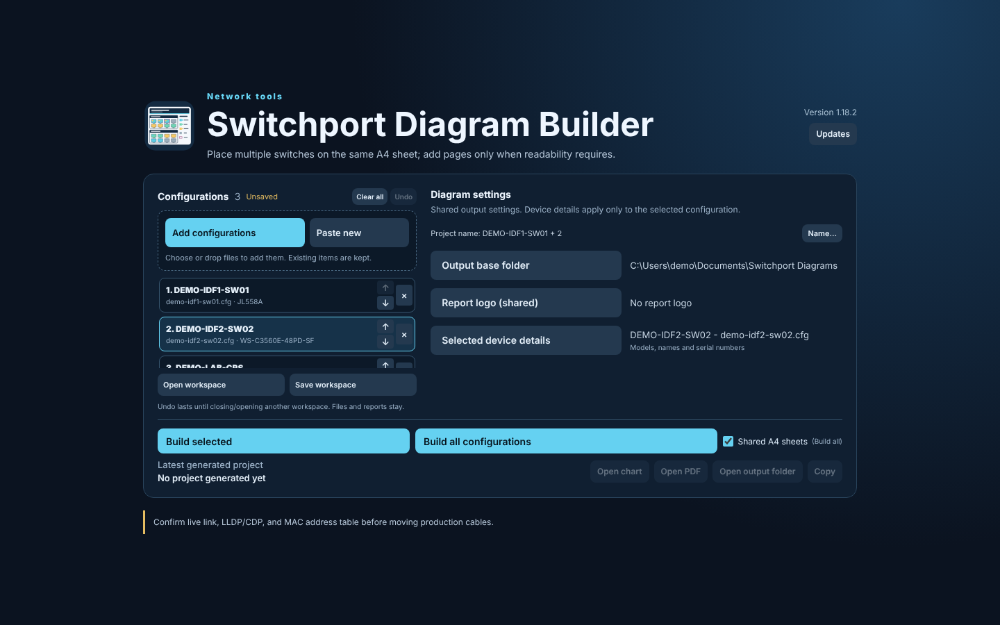
</p>

## Features

- **Map physical ports:** generate device layouts with proportional RJ45 and optical connectors, member/chassis/module identity and VLAN keys.
- **Read VLAN membership at a glance:** native VLAN fills, tagged-VLAN circles and voice-VLAN diamonds use configuration-aware colors.
- **Keep the complete inventory:** PDF tables retain full tagged-VLAN lists, with wrapped cells and continuation pages for long rows.
- **Share one sheet:** place switches from different configurations together on readable A4 sheets in workspace order, with shared VLAN/LAG colors, one combined VLAN legend and exact-sheet previews.
- **Choose installed modules:** compatible per-slot module selectors supply missing expansion-card inventory for supported switches, stack members and chassis. Automatic detection remains available.
- **Auto-detect supplementary network evidence (1.18.4):** drag and drop Auvik .xlsx reports or switch/firewall show, display and get command output alongside configurations; matching devices receive their own observed interface, neighbor, routing and DHCP/relay details. Observed fields never override VLAN, LAG, module, administrative or physical geometry configuration.
- **Organize multiple configurations:** add files or pasted snapshots, drag to reorder (or use up/down), and keep each diagram's model/device details independent.
- **Export a report package:** A4 PDF, 300 DPI PNG, CSV, JSON, a technician summary and a validation report.

## Screenshots

### Diagram and report output

Pages from a real exported A4 PDF report, with switch, VLAN and host names changed to generic examples.

**Port map of a five-member stack: native, tagged and voice VLANs, LAGs and the VLAN key**

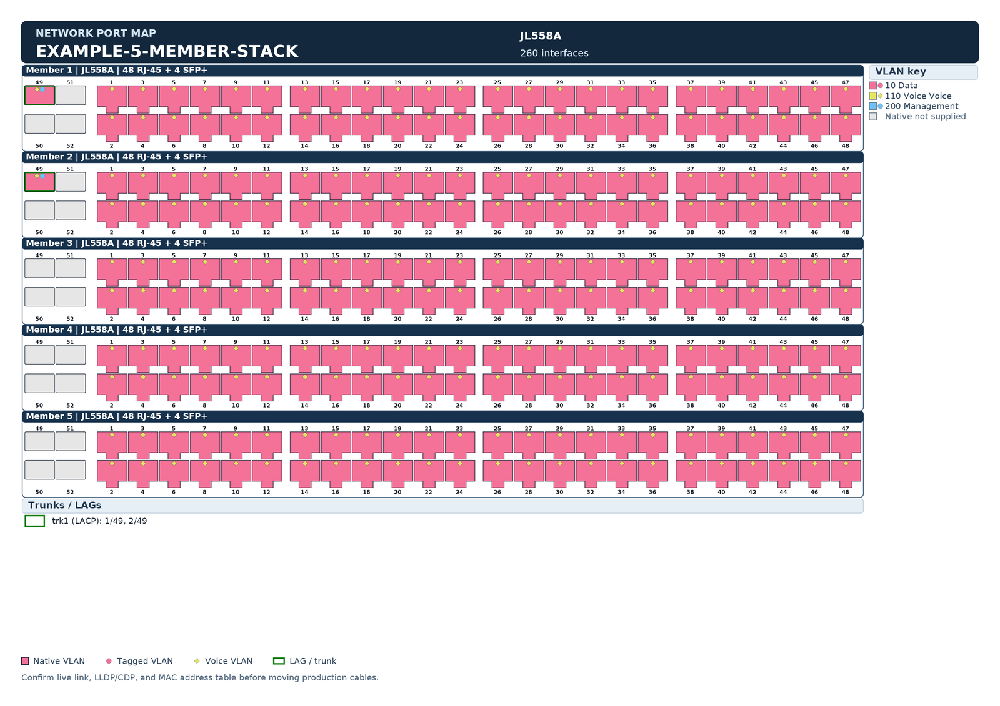

<table>
  <tr><td width="50%"><b>Eight-member stack on one sheet</b><br>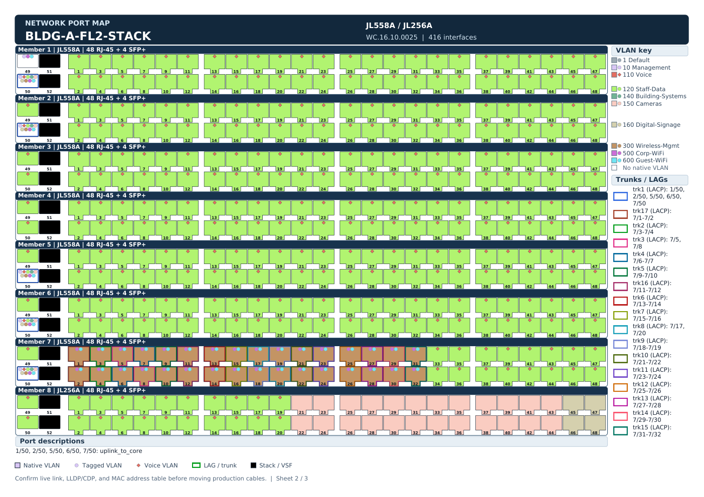</td><td width="50%"><b>Modular chassis with per-slot modules and port descriptions</b><br>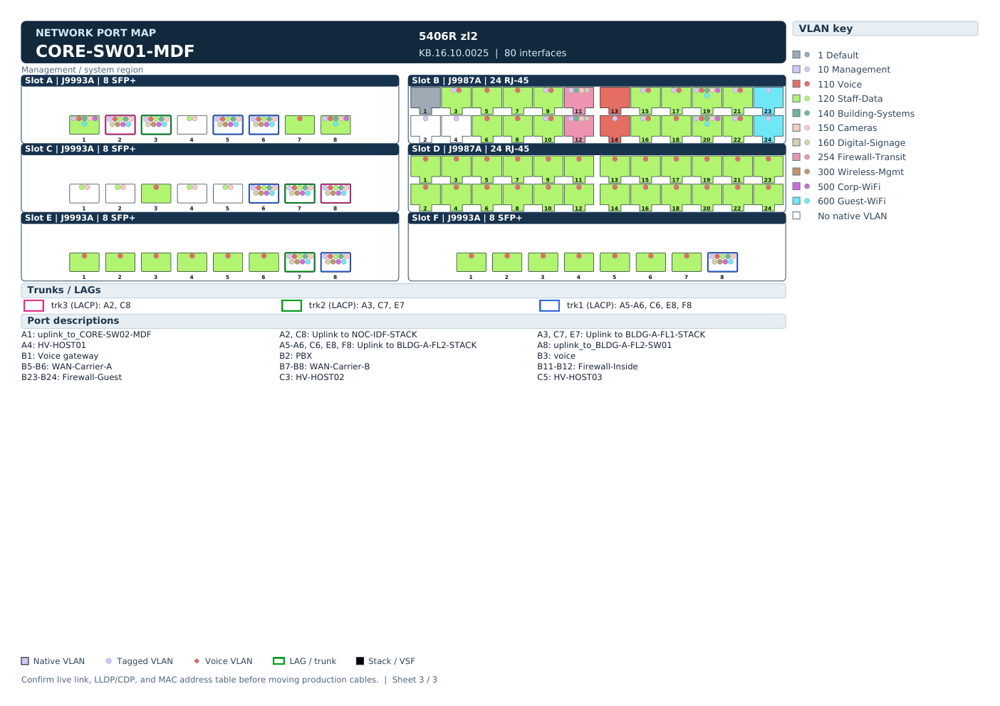</td></tr>
  <tr><td width="50%"><b>Port inventory table with full tagged-VLAN lists</b><br>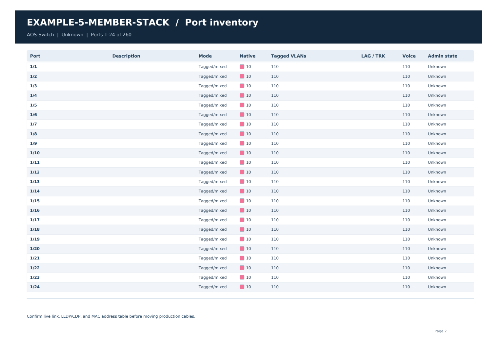</td><td width="50%"></td></tr>
</table>

### Organize multiple configurations

<table>
  <tr><td width="50%"><b>Paste a configuration into the workspace</b><br>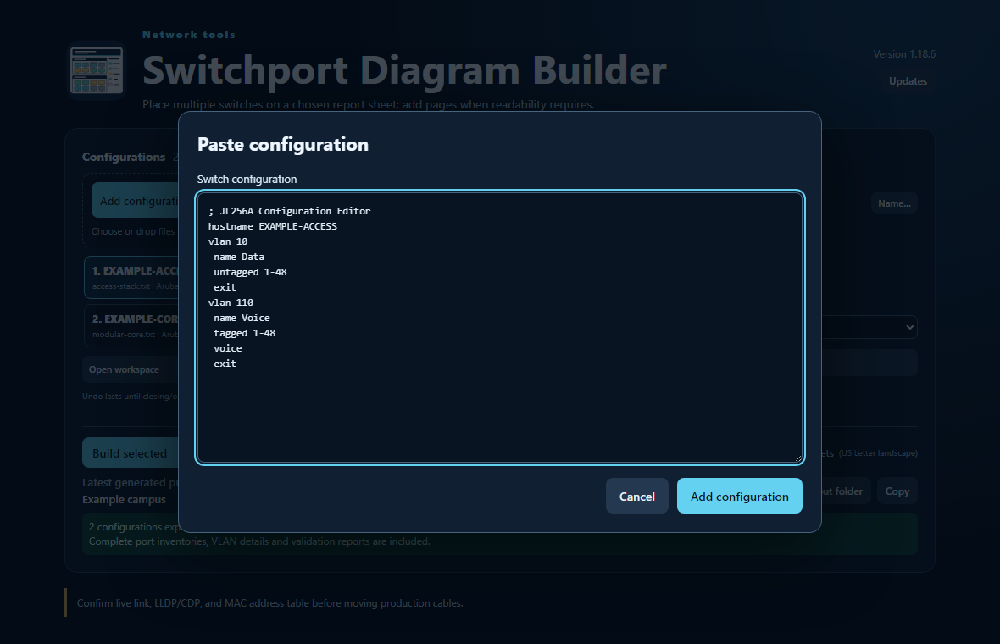</td><td width="50%"><b>Validation warning kept visible beside valid configurations</b><br>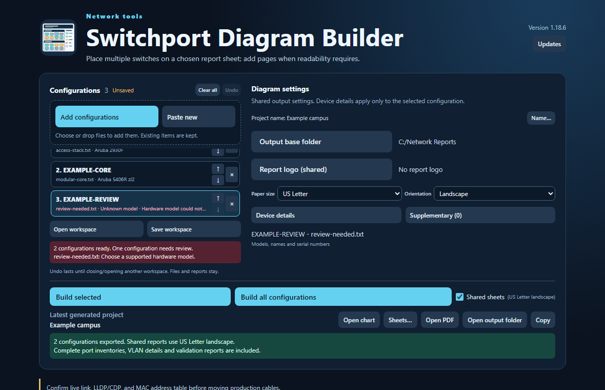</td></tr>
  <tr><td width="50%"><b>Workspace output name and shared-sheet report title</b><br>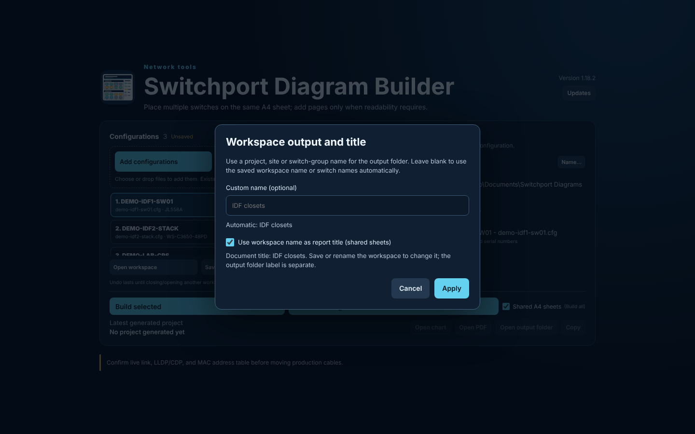</td><td width="50%"></td></tr>
</table>

### Supplementary network evidence

**Import Auvik reports or saved CLI outputs alongside a selected configuration**

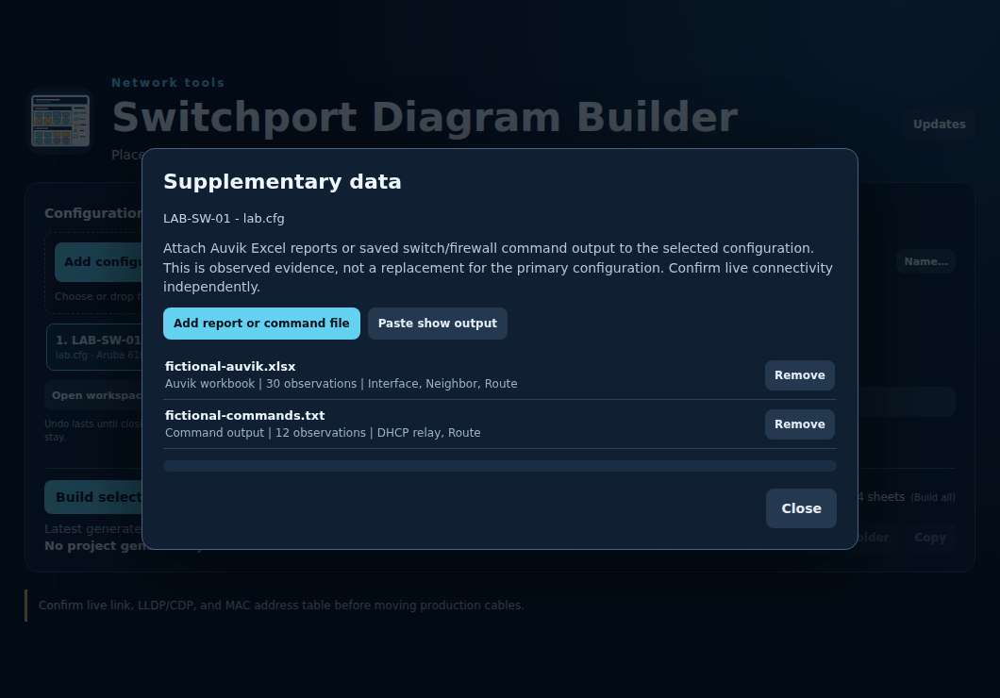

### Device and module details

<table>
  <tr><td width="50%"><b>Per-slot module selection</b><br>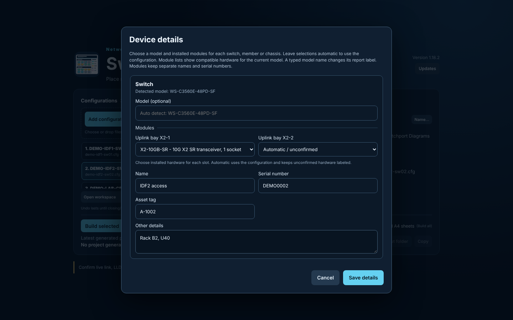</td><td width="50%"><b>Independent details for each stack member</b><br>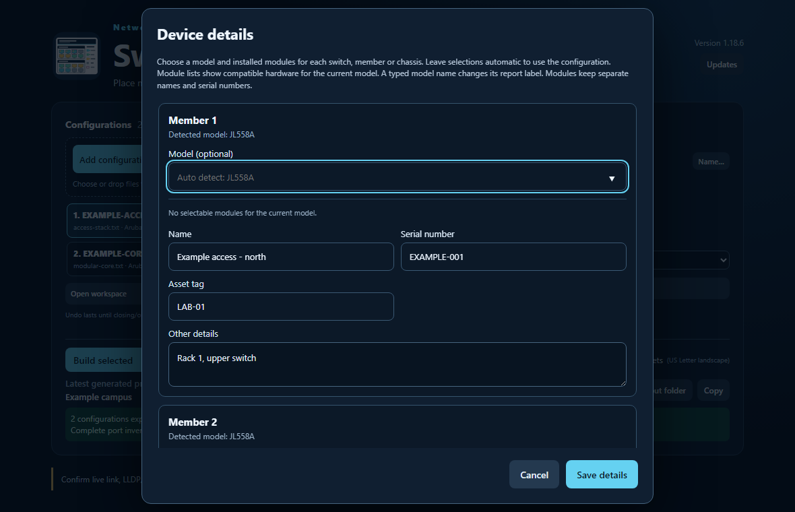</td></tr>
</table>

### Updates

**Application updates**

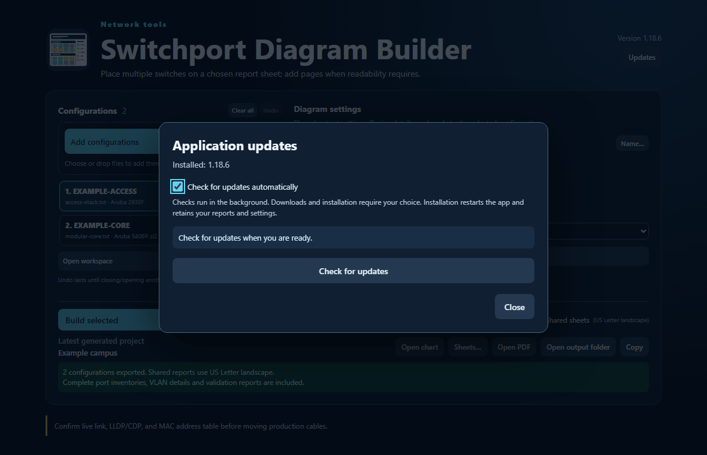

## Download

Get **`SwitchportDiagramBuilder.exe`** or the versioned **Windows x64 ZIP** from [the latest release](https://github.com/TechSavage1989/SwitchPort_Diagram_Builder/releases/latest). Extract the ZIP before launching.

## Requirements

| Requirement | Details |
| --- | --- |
| Operating system | Windows 10 or 11, 64-bit x64 |
| Runtime | Microsoft Edge WebView2 Runtime; no separate .NET installation for published builds |
| Configuration input | Supported HPE/Aruba, Cisco IOS/IOS XE and documented MikroTik RouterOS inputs |
| Coverage | Model, syntax and export-format support are bounded; check the guides below before relying on a diagram |

> **Validate before sharing:** a researched model is not automatically a supported layout. Typing a model name does not bypass physical-layout validation. Unknown hardware, conflicting identity or layouts beyond readable A4 capacity can block export rather than silently omit information.

See [hardware coverage](Source/SUPPORT_COVERAGE.md), [module support and compatibility](docs/MODULE_SUPPORT.md), [Cisco module references](docs/CISCO_MODULE_REFERENCES.md), [Cisco support and inventory limits](docs/CISCO_SUPPORT.md), [MikroTik support](Source/MIKROTIK_SUPPORT.md), [layout rules](Source/LAYOUT_SIZING.md) and [color selection](Source/COLOR_SELECTION.md).

## Getting started

1. Open [the latest release](https://github.com/TechSavage1989/SwitchPort_Diagram_Builder/releases/latest). Download **`SwitchportDiagramBuilder.exe`** or extract the **Windows x64 ZIP**.
2. Launch the executable from a writable local folder. **Microsoft Edge WebView2 Runtime** must be installed.
3. Choose one or more saved configurations, drop files into the window, or use **Paste new → Add configuration**. Imports add items; duplicate names stay separate.
4. Select a configuration in the workspace. Open **Device details**, leave its model empty for automatic detection, or supply an exact supported SKU when hardware identity is missing. Choose installed modules from the compatible dropdown for each available slot. Leave a slot automatic to use the configuration; unconfirmed hardware stays labeled. Each item retains its own member/module details.
5. Set shared output-folder/logo preferences and the selected switch's **Device details**, then choose **Build selected** or **Build all**. The unified **Open chart** and **Open output folder** always open the latest successful project, regardless of which configuration is selected.

Reports are saved in a child folder named for the switch hostname or identified model. Repeated exports create numbered folders rather than replacing earlier results.

The [complete model/module catalog](Source/ALL_MODELS_MODULES.csv) lists all 451 recorded identities, including 279 selectable switch/chassis models, 75 compatible module PIDs and 97 entries awaiting verified layouts. Version 1.18.0 corrects physical port rows, bank spacing and module positions across supported hardware. See the [manufacturer reference audit](docs/PHYSICAL_POSITION_AUDIT.md) and [catalog research and limits](docs/CATALOG_REFRESH.md).

### Supplementary data import (optional)

**Drag and drop** primary switch configurations, Auvik Excel reports (.xlsx), and supported CLI captures (.txt/.log and recognizable command-output .csv) into the main workspace, including mixed batches in any file order. The app automatically classifies them, adds primary configurations first, then matches Auvik reports by hostname across loaded switches. CLI output with a recognizable prompt matches the corresponding hostname; promptless output uses the explicitly targeted or selected configuration. Unmatched and ambiguous evidence is reported instead of becoming a switch configuration. You can also drop supplementary files directly into the Supplementary data dialog, or choose **Add report or command file** / **Paste show output**. Multiple sources per device are supported, and each can be removed separately.

- Dragged Auvik workbooks are matched by **configuration hostname** to each matching workspace device, even from a site-wide report. When importing manually in the Supplementary data dialog, the selected configuration is the target. Accepted tables include Interfaces, Devices/Network Elements, Routes, ARP Entries and Forwarding Database (FDB). Unknown or duplicate device identities require review rather than automatic assignment.
- Command text supports recognizable interface status/address, LLDP/CDP detail, route next-hop and DHCP relay entries, plus source-labeled reference lines from relevant show, display and get commands. Command formats vary by vendor: unrecognized table columns remain reference observations, not inferred configuration.
- Port neighbor, link state and speed may fill *unknown* fields in the exported inventory, labeled "Observed". They cannot replace configuration-derived VLAN membership, port modes, LAGs, interface numbering, supported hardware or layout. Historical operational data is not proof of current cabling.
- Each report package with supplementary sources includes **supplementary-data.csv** and **supplementary-data.json**. Selected operational facts appear in the existing port inventory and assumptions. Full supplementary tables do not alter the A4 physical sheet geometry or create an independent topology diagram. Workspace saves keep parsed evidence, not the source workbook or complete raw command transcript.

Auvik workbooks are read locally using the Open XML file contents; they are not uploaded. Store saved workspaces and reports securely, as IP addresses, MAC addresses and operational details can still be sensitive. In particular, imported CLI output is not a substitute for checking live LLDP/CDP, MAC tables and links before production changes.

See [supplementary import details and limits](docs/SUPPLEMENTARY_IMPORT.md).

### Ordered workspaces

Drag list items or use their **Move up / Move down** controls. Selection follows the item, not its old position. Remove affects only that item, without a repeated modal prompt. **Undo** restores its position, selection and unsaved device settings. **Clear all** empties workspace items, naming/title and palette settings; Undo restores them too. Undo history is memory-only until closing/opening another workspace; neither action deletes original configurations or generated outputs. App-wide preferences remain. Retained results are explicitly labeled as previous output when the workspace is empty. Unsupported configurations remain visible with validation warnings so you can supply missing model details without blocking the others.

**Save workspace** writes a separate versioned `.spworkspace.json` containing ordered configuration snapshots, selection and per-item details. Existing workspaces remain compatible. Saving is explicit; these files are not uploaded automatically. **Protect workspace files like the original configurations: they can contain credentials and network details.** Opening validates before replacing current items. Reopened workspaces rebuild exports rather than trusting external output paths.

The generated workspace folder defaults to the **saved workspace filename**. Before saving, it derives a compact label from switch names/models. Use **Name…** for an optional custom output label (clear it to return to automatic naming). A renamed workspace uses its new filename when reopened, unless you explicitly set a custom label. The **base output folder** remains separate; repeated exports use `Name (2)`, `Name (3)` rather than overwriting.

**Build all configurations → Shared A4 sheets** is enabled by default. Multiple complete switch diagrams from separate configurations share each sheet in list order, with each switch's own header, minimal separation, one shared symbol key at the bottom and one deduplicated VLAN legend at the side per sheet. Source filenames are omitted from switch headers. No generic workspace title bar is added. Common reference port geometry and readable labels are retained; another A4 page is added when the next complete switch block or a complete readable side key cannot fit. Dense chassis/stack configurations can require their own sheet and are explicitly reported. A complete configuration that fits a readable standalone side-key layout stays together: if compact layout cannot accommodate its details, it receives a dedicated fresh page using the standalone solver before continuation is considered. It never splits just to fill leftover page space. If merging individually fitting side VLAN keys would overflow, the next whole configuration starts a fresh page. A workspace title can share the existing top header on a tightly fitting dedicated page. Trunk/LAG memberships and port descriptions that genuinely exceed fresh-page capacity continue onto clearly labeled detail sheets with the switch identity, side VLAN key and bottom icon key. Text is wrapped at readable size, including unusually long individual descriptions; physical socket geometry is not squeezed. **Sheets…** previews the actual exported PNG pages of the latest multi-switch project; the PDF uses the same vector scenes. The combined booklet begins with shared sheets, followed by complete per-switch inventory/detail pages. Individual eight-file packages and **Build selected** remain available.

**Optional document title:** open **Name…**, enable **Use workspace name as report title (shared sheets)**, and Apply. It is off by default. The title uses the saved workspace filename (for example, a closet/location); unsaved workspaces use switch identities. The custom output folder label is separate. Save the workspace to retain the option; rename/save the workspace to change its title. Both individual and combined diagrams place the symbol/icon key in a reserved bottom band above the safety footer.

**Shared colors:** matching **VLAN IDs** receive one shared color and key entry across all configurations, regardless of name. Differing names are retained as aliases; blank names do not create separate identities. The combined key stays beside the diagrams, with readable continuation pages when necessary. Matching trimmed, case-insensitive **LAG labels** still share contrast-checked outline colors; colors do **not** imply physical connections. Mappings survive reorder, selection and save/reopen and apply to individual workspace exports too. Consistent legacy ID/name overrides migrate to ID-only keys; contradictory old choices are rejected with an explicit resolution message rather than choosing by list order.

Invalid configurations are reported independently, while valid ones still export. **Build & results** keeps one latest-successful project: **Open chart**, **Open output folder** and **Copy** follow it, whether it was built from one configuration or all configurations. Selection never redirects these actions. Source/order/settings changes mark the result as an earlier build without removing access; failed or cancelled builds preserve it. **Open chart** opens the first available project PNG in the image viewer, never a PDF. **Open PDF** is a separate action. For multiple sheets, **Sheets…** previews the pages; **Open PNG** opens the displayed page. Output directory, report logo and update preferences remain app-wide; device/model details remain independent per configuration.

See [workspace format and development handoff](docs/DEVELOPMENT_HANDOFF.md) and [1.18.2 release notes](docs/releases/1.18.2.md).

## How to use

| Output | Purpose |
| --- | --- |
| `wall-chart.png`, `a4-one-page.png` | A4 landscape port maps at 300 DPI |
| `a4-one-page.pdf` | Single-page visual diagram |
| `a4-booklet.pdf` | Diagram followed by detailed port inventory |
| `port-map.csv`, `technician-summary.txt` | Tabular data and a readable summary |
| `inventory.json`, `validation-report.txt` | Complete inventory and diagnostic records for internal review |

The validation report records assumptions and provenance. Review it alongside the diagram; configuration exports do not establish live device state.

## Updates and settings

Open **Updates** for manual checks, release notes, download progress, reminder delay and the automatic-check setting. Automatic checks are enabled by default and run shortly after startup and periodically while the app is open.

**Download and installation are separate actions.** Installation requires explicit confirmation and waits for report generation to finish. The updater verifies package/executable SHA-256 hashes and Windows executable identity. It retains the previous executable and attempts recovery if the new interface does not become ready after restart.

Current builds are not Authenticode signed. Checksums verify integrity through the trusted release repository; they are not a code-signing certificate.

Settings, your report logo and generated reports persist between sessions and future updates. **1.12.1 starts the current application identity:** install it from the release download. Earlier builds are historical and do not update into this identity.

See [UPDATING.md](docs/UPDATING.md) for writable-folder requirements, trust limitations and recovery instructions.

## Development

<details>
<summary>Build, checks and release safeguards</summary>

Read [DEVELOPMENT.md](DEVELOPMENT.md) for the source layout, checks and release safeguards. Editable application, generator, resources and regression checks are in [Source](Source/). Keep private configuration backups and generated client reports out of the repository.

The Windows host uses .NET 8, WinForms and WebView2. The generator and shared updater validation library also build on Linux.

Build with the .NET 8 SDK:

```sh
dotnet build Source/SwitchportDiagramBuilder/SwitchportDiagramBuilder.csproj -c Release
```

Publish a self-contained Windows executable:

```sh
dotnet publish Source/SwitchportDiagramBuilder/SwitchportDiagramBuilder.csproj -c Release -r win-x64 --self-contained true -p:PublishSingleFile=true -o artifacts/windows
```

Package with [scripts/package_release.py](scripts/package_release.py). The [build workflow](.github/workflows/build-and-release.yml) defines the complete regression checks and publishes new versioned releases after a successful main build. Existing published releases are not overwritten; documentation updates must not bump the application version.

Source is available in this repository and GitHub's versioned source archives. Update ZIPs contain application/update files, not user configurations. Native helper tests do not replace interactive Windows/WebView2 and real restart testing.

</details>
